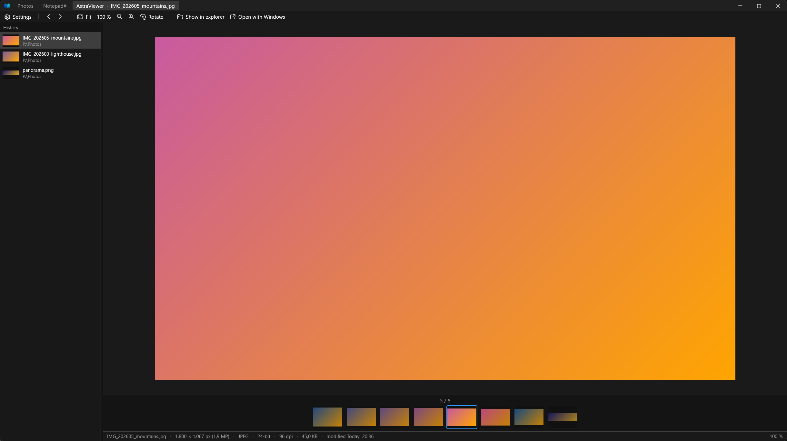

# DirectoryFable

A two-pane file manager for Windows with a built-in text editor, Notepad#, an
image and PDF viewer, AstraViewer, a fast file search, SonnetSearch, and a video
player, OpusHC.
Dark, dense and made for the keyboard. Written in C# with WPF on .NET 10.


## Download

Get `DirectoryFable_<version>.zip` from the
[latest release](https://github.com/KintaroModding/directoryfable/releases/latest),
unpack it into a folder of its own and start `DirectoryFable.exe`. It needs the
[.NET 10 Desktop Runtime (x64)](https://dotnet.microsoft.com/download/dotnet/10.0).
Later versions come through the `Update` button in the title bar. To build it
yourself, see [Build](#build).

## Explorer

- **Two panes with tabs.** Each tab keeps its own folder, history, sort order
  and columns. The `+` adds a tab at the very right, at This PC (a setting
  makes it the current folder instead); `Ctrl+T` adds a copy of the current
  tab next to it, `Ctrl+W` closes a tab, `Ctrl+Shift+T` brings back a closed
  tab. Drag a tab to move it.
- **Folder tree and favorites bar**, shared by both panes; they act on the
  active pane. The tree shows Home, Favorites, Desktop and This PC. It follows
  the active pane, or stays where it is (toggle in its header). "Collapse all"
  goes back to the overview. "Folder tree: Network" on the settings page (off
  by default) adds a **Network** group: this computer and the servers of
  mapped drives, favorites and recent folders, plus the computers that
  Windows' network discovery finds (added as they come in). Open a computer
  to see its shares; `F5` on the group searches again.
- **Address bar** with clickable parts; it turns blue on a network path
  (`\\server\share` or a mapped network drive). Type a path with `Ctrl+L`, `Alt+D` or
  `F4`; environment variables like `%APPDATA%` work.
- **This PC**: the drives with a usage bar (red from 90 % used), file system,
  how full and free of total, in "Devices and drives" and "Network locations"
  (with the share). For local and removable drives also the disk behind them
  ("SSD · NVMe", "HDD · SATA", "USB") and its health as Windows reports it: a
  green, orange or red dot with Healthy / Warning / Unhealthy, the temperature
  and, for SSDs, the life left (temperature and life need administrator
  rights). Open it from the tree, by typing `This PC`, or with Up from
  a drive. Double-click or `Enter` opens a drive, a middle click opens it in a
  new tab, right-click shows Windows' menu for it ("Space usage" opens the Space
  view); the values update while you look. Below the drives: **Recent folders**,
  the folders you opened last in any pane or tab (how many: settings page, 0 to
  100; right-click one to remove it from the list).
- **Details view** with group dividers by file type. Sort, resize and reorder
  the columns. Hidden and system files are always shown.
- **Folder sizes** in the Size column (NTFS drives, run as administrator): the
  first folder on a drive reads its file table once (about a second for a
  system drive), then every folder on it shows its size at once; sorting by
  size and the status bar count them too. The sizes stay live: every few
  seconds (10 by default, a setting) DirectoryFable looks at the drive's change
  journal (Windows' list of file changes) and lists only the folders that
  changed again; `F5` reads the whole drive again. Only reading, nothing is
  written to the drive (a drive without a journal is read again at most once a
  minute after a change). Switch it off on the settings page or in the column
  header's right-click menu.
- **Space view** (`Space` button in the quick bar): what takes the space in the
  shown folder, biggest first. Folders show the size, files and folders of
  everything below them, and every row has a bar for its share; at a drive
  root also files, other used space and free space. Open a folder to go deeper
  (Back, Up and the address bar work as usual), `Esc` returns to the list, `F5`
  reads again. NTFS drives as administrator are read from their file table;
  network folders and other drives with a folder walk. Below the list a **block
  chart**: every file and folder as a box sized by its space, files coloured by
  kind (video, images, archives, programs, ...); point at a box to see its path
  and size, click to select its row, double-click to open. `Blocks` switches it
  on and off; drag the line above it to change its height.
- **Thumbnails** (button in the quick bar, after Space): the list as large
  tiles with Windows' own thumbnails (videos with their length, pictures,
  documents; other files with their icon), the name and the size. Always in
  categories: folders first, then videos, images and other files, each under
  its own header. Selection, keys, the right-click menu, drag and drop, rename
  and the quick filter work as in the rows. The slider next to the button (or
  `Ctrl`+mouse wheel) sets the size; per tab, it stays on in other folders.
- **Quick filter**: type in the list and only the names that match stay
  (words in any order, `*` and `?` as wildcards); the box at the right end of
  the quick bar shows the text and "shown / all". `Backspace` takes back a
  character, `Esc` shows all again, another folder starts without a filter.
- **Auto-refresh**: the lists and the tree follow changes on disk.
- **Compare** (a toggle next to `Refresh both`, in the bar under the title
  bar): while it is on, each row and tile shows how it stands against the
  other pane: `only here`, `newer`, `older` or `differs` (the same time,
  another size). It compares the names in the two shown folders (not inside
  subfolders; folders by their name only); times up to 2 seconds apart count
  as the same. Turning it on selects in each pane what is only there or newer
  there, ready for Copy to other. The status bars show the counts, and the
  marks follow changes and other folders. Click again to end.
- **File operations through Windows** (Recycle Bin, elevation).
- **Own question for names that are taken**: before a copy or move starts,
  DirectoryFable finds the names that already exist in the target (also inside
  folders that are merged) and asks in a dark dialog: Replace, Replace if newer,
  Skip or Keep both (`name (2).ext`), with sizes and dates side by side (newer
  and larger marked) and "do the same for the other conflicts" ("if newer" then
  decides for each item by its own dates). Cancel changes nothing. **Undo** (`Ctrl+Z`) for copy, move, rename, duplicate and delete
  to the Recycle Bin.
- **Own dark progress window** for copy, move and delete: from / to, the
  current item, current and average speed (items per second for a delete),
  elapsed time and time left, items and size left, Pause / Resume and Cancel
  (closing the window cancels too). `Shift+Delete` asks in a dark dialog; when
  Windows has a question of its own (an item that cannot go to the Recycle Bin,
  a file in use), it stays in front of the window. `Details`
  slides open the full paths of from, to and the current item (right-click one
  to copy it). It shows only for operations that take longer than a moment.
- **Rectangle selection**: hold the left button on empty list space, or on a
  row outside its name, and drag; `Ctrl` adds to the selection. The list
  scrolls when you drag past its top or bottom.
- **Drag and drop** between the panes, tabs, the tree, the favorites and other
  programs. A right-button drag asks what to do; dropped into the same folder,
  it makes a copy under a new name. Archives (ZIP; 7z and RAR with 7-Zip) dragged with the
  right button offer **Extract here** and **Extract to "name\"** too, also in
  their own folder. 7-Zip unpacks them when it is installed (also ZIP files),
  WinRAR unpacks RAR files when it is installed; both are found automatically,
  or set their folders in Settings, Tools. A drag shows Windows' drag picture (the
  file's icon or thumbnail, a count for several) and what a drop would do
  ("Move to Documents").
- **Paste from another computer**: files copied in a remote desktop or a
  virtual machine window, a mail attachment or a phone's files have no path
  on your disks. `Ctrl+V` hands them to Windows, which gets them into the
  shown folder with its own copy window; you keep working meanwhile.
- **New folder** (`Ctrl+Shift+N`, the right-click menu, also Windows' own
  `New > Folder` there) and **Rename** (`F2`, the right-click menu) use one
  name dialog. New folder offers the first free "New folder" name; Rename
  selects a file's name without its extension, so typing keeps the type, and
  names a shortcut without its hidden `.lnk`. The name is checked while you
  type (characters Windows does not allow, names it keeps for itself, a name
  that is already there); a new file type is pointed out. A rename can be
  taken back with `Undo`.
- **The Windows context menu** in dark mode, so your shell extensions work.
- **Quick actions bar** in each pane, in two rows. First: Folder path, File
  path, Copy, Cut, Paste (as `Ctrl+C`, `Ctrl+X`, `Ctrl+V`), 7z (7-Zip's "Add
  to archive" window), Duplicate, Copy to other, Move to other, Delete (to the
  Recycle Bin, as the `Delete` key; the arrow next to it deletes permanently
  after a question, as `Shift+Delete`). Second: GemmaChat (a new chat that
  works in this folder), Terminal (Command Prompt or PowerShell), Explorer,
  SonnetSearch (search this folder and its subfolders, like `Ctrl+F`), Space
  (the Space view), Thumbnails, and the quick filter box. "Quick bar: icons only" on the
  settings page hides the labels for narrow panes.
- **Archives as folders**: ZIP read and write; 7z and RAR read only, through an
  installed [7-Zip](https://www.7-zip.org/).
- **Properties window** (`Alt+Enter` or the info button on a row): first
  General, as Windows' General tab (type, location, size and size on disk with
  the exact bytes, what a folder contains - counted while you look -, dates,
  attributes; drives: capacity, used, free, file system), then the details
  Windows knows for the file type (for example image size, artist, page count).
  Read-only, Hidden, System and Archive are check boxes that change the item at
  once. Size on disk is counted as Windows counts it: the space the file system
  has reserved for each file, with its named streams such as the "downloaded
  from the internet" mark (tiny files and streams that NTFS keeps inside its
  file table count 0; compressed and sparse files count what is stored; every
  name of a hard link counts).
- **Status bar**: selected and total folders, files and size; free space. The
  right pane also shows DirectoryFable's RAM use (as Task Manager's Memory
  column, every 2 seconds).
- **Settings page** behind the gear button. A normal window with a taskbar
  button (the default), or tray mode: only a tray icon, and closing the window
  hides it. Only one copy runs. "Start hidden" (off by default) starts without
  showing the window: hidden in tray mode until the tray icon is clicked,
  minimized in taskbar mode.
- **Session**: window, tabs, columns and the open Notepad# files come back at
  the next start.

## Notepad#


- A second view in the title bar: `[folder] [Notepad#]`. Both views keep their
  state.
- **Open files in a vertical list**, in groups of your own and in automatic
  groups (by type or by folder). Drag files and groups to order them.
- **Icons for files**: right-click a file in the list, `Icon`, and pick one of
  24 (star, flag, bug, to-do list ...). A red dot on it shows unsaved changes.
  `Default icon` goes back to the normal symbol. The icons are kept in the
  session.
- **Editor** based on [AvalonEdit](https://github.com/icsharpcode/AvalonEdit):
  line numbers, syntax highlighting chosen per file, and word wrap (`Alt+Z`).
  Languages: the ones AvalonEdit knows (C#, C++, Java, JavaScript, Python,
  PHP, PowerShell, SQL, HTML, CSS, XML, JSON, Markdown and more) plus
  AutoHotkey, Batch, Dockerfile, Go, INI, Kotlin, Log, Lua, Makefile,
  Registry, Ruby, Rust, Shader (GLSL / HLSL), Shell script, Swift, TOML,
  TypeScript, YAML and Technical Notes. The arrows left of the Language menu
  step through them in the menu's order, to try one after another.
- **Technical Notes**: highlighting for plain-text notes and logs: dates and
  times, status words (`TODO`, `FIXED`, `ERROR`), paths, file names, dotted
  members, brackets (colored by depth), quotes, numbers; capitalized words
  always stand out. `.tnotes` files get it at once; for any other file choose
  it in the Language menu.
- **Search** (`Ctrl+F`) in a dark search box: match case, whole words, regular
  expressions. **Replace** (`Ctrl+H`, or the arrow on the left of the search
  box): Replace (`Enter`) and Replace all (`Ctrl+Alt+Enter`, one Undo takes it
  back); with a regular expression `$1`, `$2` take the groups of the match.
  **Find all** (button in the search box, or `Alt+Enter`) lists every line of
  the file with a match in the panel below, the matches colored; a click on a
  line (or the arrow keys) shows it in the editor, a double-click or `Enter`
  goes there.
- **Theme** menu (left of Language): the look inside a file. `Default` is
  the look Notepad# always had; `VS Code` follows VS Code's dark theme (a
  near-black background, gray comments, light blue strings, purple methods).
  `Midnight` is DirectoryFable's own: a deep blue-black background with soft
  contrast, cool blue keywords and methods, warm strings and numbers.
  The choice holds for all files and is kept.
- **Word highlight**: a click into a word marks every place of that word in
  the file with a gray box (whole words, capital letters do not matter), as
  in VS Code.
- **Find in files** (`Ctrl+Shift+F`): a panel above the status line searches a
  folder and its subfolders (not `.git`, `.vs`, `node_modules`, `bin`, `obj`)
  with the same options, in all files or in patterns such as `*.cs *.xaml`.
  The hits are listed as file:line with the line; a double-click (or `Enter`)
  opens the file at the hit. Binary files and files over 64 MB are skipped.
- **Minimap** beside the scroll bar: click to jump, drag to scroll.
- **The full path** of the shown file just above the first line; right-click
  it to copy it or to show the file in the explorer.
- **New files** (`Ctrl+N`) and **Save as** (`Ctrl+Alt+S`).
- **Nothing is lost on exit.** Unsaved changes and new files that were never
  saved come back at the next start, also after a crash (they are kept a few
  seconds after you stop typing). `Ctrl+Z` after a restart goes back to the
  saved text.
- **Changes from other programs**: a file without unsaved changes is reloaded
  by itself; with unsaved changes, Notepad# asks first.
- Files keep their encoding and line endings.
- **A file deleted outside stays in the list** in red and read-only, with its
  text, also after a restart. Save writes it back.
- **Open from the explorer** with the context menu, `Ctrl+E`, by dragging files
  onto the `[Notepad#]` tab or into Notepad#, or with a double-click on the file
  types you choose. The double-click works only inside DirectoryFable; the file
  associations of Windows do not change.

## AstraViewer



- A third view in the title bar: `[folder] [Notepad#] [AstraViewer]`.
- **Opens only from DirectoryFable**: a double-click (or Enter) on the image
  types you choose (and PDF), "Open in AstraViewer" in the right-click menu, or
  files dropped onto the `[AstraViewer]` tab. The file associations of Windows
  do not change.
- **History** on the left: the images you opened, the newest at the top.
  Click one to show it again; the order stays. A right-click on the image or
  on a thumbnail adds that image ("Add to history").
- **The image** fits into the window (or starts at 100 %). Mouse wheel = zoom
  at the mouse, drag = move, double-click = fit / 100 %, `R` = rotate the view
  (Save writes it into the file). Transparent parts show a checkerboard. The
  bar shows the current zoom between its zoom out and zoom in buttons.
- **Simple edits** in the bar: **Crop** (drag a frame on the picture or its
  eight handles, an aspect list: free, as the picture, 1:1, 4:3, 3:2, 16:9
  and upright; `Enter` or a double-click in the frame crops, `Esc` cancels),
  **Resize** (width and height in pixels, the aspect ratio kept or not, 25 /
  50 / 75 / 200 %), **Save** (`Ctrl+S`: into the same file, after a
  question; the original goes to the Recycle Bin first) and **Save as**
  (`Ctrl+Shift+S`: JPEG, PNG, WebP - lossy or lossless -, BMP, TIFF or GIF).
  `Ctrl+Z` takes back the last edit. JPEG keeps the photo's date taken and
  camera; transparent parts become white in JPEG and BMP. A WebP file stays
  lossy or lossless as it was. Going to another picture with unsaved edits
  asks first. Not for animated or multi-size images (and ICO, HEIC are saved
  with Save as, as Windows cannot write them).
- **Thumbnails** of the other images in the folder, with "n / N", like VS
  Code's image preview. The arrows next to "n / N", `Left` / `Right` or the
  mouse side buttons go to the previous / next image.
- **Properties** below: size in pixels, format, color depth, DPI, file size,
  dates, camera (when the photo has it).
- Settings: start zoom, background (dark, black, light), checkerboard,
  thumbnail size (small, medium, large), history size, and the image types. JPEG / TIFF orientation (EXIF) is applied; icons
  show their largest size; very large images are decoded smaller.
- Formats: those that Windows can read (PNG, JPEG, BMP, GIF, TIFF, ICO, WebP,
  JPEG XR; HEIC and AVIF with the matching Windows codecs). Animated GIFs show
  their first frame.
- **PDF**: the pages one below the other, drawn by PDFium, the PDF engine of
  Chromium (only the pages in view). Fit (the start) shows every page whole, each by
  its own size, and the mouse wheel, `Up` / `Down` and `Page Up` / `Page Down`
  go a whole page back or on. Zoomed (`+`, `-`, `Ctrl`+wheel at the mouse;
  100 % = the paper's real size), the wheel scrolls; `F` fits again. The bar
  shows the page in view ("3 / 12"), `Home` / `End` go to the first / last
  page; `Left` / `Right` still go to the previous / next file. The **page
  rail** on the right shows all pages small: the page in view is marked and
  stays in its upper part, so the next pages show below it; a click goes to
  a page, the wheel scrolls the rail. **Text**: drag over it to select
  (double-click a word, triple-click a line, `Ctrl+A` the page; one page at
  a time), `Ctrl+C` copies it; without a selection `Ctrl+C` copies the page
  in view as a picture. **Find** (`Ctrl+F`, or `Find` in the bar): type a
  text and all pages are searched; the hits are marked on the pages (the
  current one stronger) and counted ("3 of 17"). `Enter` / `F3` go to the
  next hit, `Shift+Enter` / `Shift+F3` to the previous one, `Esc` closes
  the search. Capital letters do not matter, and the text may run over a
  line end. A PDF with a **password** asks for it in the viewer
  (kept until DirectoryFable closes, never saved). The properties show the
  page count and the paper size (A4, Letter, ...).
  Updating adds `.pdf` once to an older type list; take it out there to keep
  PDFs in their own program.

## SonnetSearch

- The fourth view in the title bar, `[SonnetSearch]`. `Ctrl+F` in the explorer
  searches the shown folder and its subfolders.
- **Whole drives in seconds**: run as administrator, DirectoryFable reads each
  NTFS drive's file table directly (millions of files in a few seconds; it only
  reads). Without administrator rights, and on other drives, it walks the
  folders instead (slower).
- **Name search while you type**: words in any order, `*` and `?` wildcards
  (`*.sav`), "quoted text", match case, regular expressions.
- **Places**: drive toggles in the bar, plus a drop-down list of drives (total
  size, free space, % free) and added folders, each with a tick box and a
  folder tree to tick subfolders. Ticked folders show in the bar.
- `Reset` empties the text and the filters (places and the mark stay).
- **Filters**: type (files, folders, images, text, own extensions), size, and
  a date range for Last Modified, Creation Date, Last Accessed or any of them.
  The size filter also takes folders by their size (all files below them);
  type "Files" leaves the folders out.
- **Containing**: text inside the files. `Enter` in its box searches: only the
  files found by the name and the filters are read (four at a time, the
  progress in the status line, `Esc` stops), with `Aa` for match case. Binary
  files and files over 64 MB are skipped. What a file holds is remembered
  (until its size or date changes), so the next search with other filters is
  quick.
- **Duplicates** (a toggle after Containing): only the found files whose
  content another found file has too, in groups, the largest files first.
  Files of the same size are compared: first their first 64 KB, then the
  SHA-256 checksum of the whole file. Empty files are left out; hard links
  (one file under two names) count once. The `#` column shows the group, and
  the background changes from group to group; the status line counts the
  groups and the space that one copy per group would free. A header click
  sorts inside the groups. `Select all but one` selects every file of each
  group except its first row (sort to choose which one stays). Use the name
  and the filters (for example "At least 1 MB") to compare fewer files; `Esc`
  stops. It is only ever switched on by hand: other text in the name box,
  `Ctrl+F` in the explorer and the next start switch it off (the filters
  keep it on).
- `Delete` in the results moves the selected files to the Recycle Bin and
  takes them off the list (`Undo` in the explorer brings them back).
- **Time mark**: `Set mark` remembers the moment; "Since the mark" then shows
  only what changed after it (for example where a game wrote its save file).
- Columns: `#` (row number), Name, Containing Path, Size, Last Modified,
  Last Accessed, Creation Date, Type; every second row is a little lighter.
  A folder's size is the size of all files below it (with "Folder sizes" on
  in the settings), so folders sort by size together with the files. Click a
  header to sort (size and dates: biggest / newest first). The results open,
  drag, copy and have the Windows menu like the files in the explorer.
- **Scroll rail** instead of a scroll bar: the thumb stays big enough to grab
  with millions of results, and a click anywhere jumps there. With the mouse
  on the rail, a panel shows where each part of the sort order starts
  (`Today`, `Oct 2026`, `≥ 1 GB`, `A`, `C:\Users`, `.txt`) and a bubble shows
  the value and row at the cursor. Click a label to go to the start of that
  part.
- A drive is read once; typing and filters search what was read. `Enter`,
  `F5` or `Search` read the drives again, so new files show.

## OpusHC

- The fifth view in the title bar. A double-click (or `Enter`) on a video in
  the explorer plays it here; the types are a setting (MP4, MKV, MOV, AVI, WebM,
  ... by default). Only inside DirectoryFable: Windows' defaults stay.
- **VLC's engine, portable**: it plays with libVLC from the VideoLAN project,
  which is not part of the download. Until it is there, OpusHC shows why it is
  needed, the exact address it comes from and the exact folder it goes to, with
  a Download button: the official VLC zip from download.videolan.org (about 79
  MB), checked against VideoLAN's SHA-256 checksum; only the engine files (about
  140 MB) are kept in `data\vlc\` next to the exe. Nothing is installed in
  Windows; `Remove` in the player's settings (or deleting the folder) takes it
  away.
- Timeline with scrubbing (drag it and the picture follows; the time under the
  mouse shows above it), play / pause, previous / next video in the folder,
  volume and mute, audio track and subtitles, full screen (the controls hide
  while the mouse rests).
- **Filmstrip** above the timeline: the whole video as a row of small pictures
  (made in the background in a few seconds, kept in memory only). Point at it,
  or at the timeline, to see the picture of that moment bigger; click to jump
  there. In the player's settings: on / off, and a slider for how many
  pictures (20 to 200; 40 by default).
- **Close video** in the player's bar: the video stops, the file is free
  again (to move or delete it), and OpusHC is empty, also after a restart.
  Where it stopped is kept for resume.
- **Resume**: a video starts where you left it (the last 300 videos). At the end
  the next video of the folder plays (for series). Both are settings.
- Keys: `Space` play / pause, `Left` / `Right` 5 s (`Ctrl`: 30 s), `Up` /
  `Down` or the mouse wheel volume, `M` mute, `F`, `F11`, `Alt+Enter` or a
  double-click full screen (`Esc` leaves), `Page Up` / `Page Down` previous /
  next video, `Home` from the start.

## KeeSeek

- The sixth view in the title bar: your passwords in one encrypted file,
  `data\keeseek\vault.kseek` next to the exe. Nothing leaves the PC.
- **Master password**: the first visit creates the vault (the password twice);
  after that KeeSeek opens locked and asks for it. There is no way back from a
  forgotten master password.
- **Encryption**: AES-256-GCM; the key comes from the master password through
  PBKDF2-SHA256 with 600,000 rounds and a random salt. Every save keeps the
  previous version as `vault.kseek.bak`.
- **Categories** on the left ("All entries" first), each with an icon: drag
  them into your order (or `Alt+Up` / `Alt+Down`); new, rename, icon, delete
  with a right-click.
- **Colors and dividers**: any entry can have a color (12 ready colors or your
  own `#RRGGBB`): a light tint and a stripe on its row, a frame on its card.
  "Show as a divider" turns an entry into a bar with only its title
  in its color, to set your own sections; dividers are not counted and not
  searched.
- **Your order for the entries too**: drag a row up or down (or `Alt+Up` /
  `Alt+Down`); drag it onto a category on the left to move it there. "Sort
  entries A-Z" in a category's right-click menu sorts it once.
- The entries of the chosen category as **rows** (or as **cards**, a switch in
  the bar): title, user name, password (hidden; the eye shows it), web address,
  when it changed. In the rows: `Enter` edits, `Ctrl+B` copies the user name,
  `Ctrl+C` the password, `Ctrl+U` opens the web address. The row height is a
  setting (16 to 88 pixels, 52 by default; below 28 the rows are compact).
- **A click copies** a user name or password. The copy stays out of Windows'
  clipboard history and cloud clipboard and is cleared after 20 seconds (a
  setting, 5 to 120), but only if the clipboard still holds it. A click on the
  web address opens it in the browser.
- **Search**: just type; all categories are searched (title, user name, web
  address, notes, category).
- **New entry** (`Ctrl+N`) or a double-click on a card: title, category, user
  name, password with a **generator** (length 8 to 64, letters, digits,
  symbols) and a strength bar, web address, notes. `Ctrl+S` saves.
- **Import CSV**: entries from a CSV export of another password manager (groups
  become categories); afterwards KeeSeek offers to delete the CSV file, since it
  holds the passwords as plain text.
- **Export CSV**: all entries (not the dividers) as a CSV file for another
  password manager or a copy, after a warning (the file holds the passwords as
  plain text). Columns Group, Title, Username, Password, URL, Notes, Created,
  Last Modified; the groups are `KeeSeek/<category>`, so Import CSV takes the
  categories back.
- **Locking**: `Ctrl+L` or Lock; by itself after 10 minutes without use (a
  slider, 1 to 60; fully left: no timer, it locks when you leave KeeSeek);
  always when Windows locks and when the window closes.

## GemmaChat

- The seventh view in the title bar: chat with an AI without a browser
  window. It works with Claude (Anthropic's API, through the official
  Anthropic SDK) and with any provider that offers an OpenAI-compatible chat
  API: OpenAI (GPT), DeepSeek, a local Ollama or LM Studio (free, nothing
  leaves the PC), and many more.
- **Settings**: providers with their API type, address, API key and model;
  "Add" offers ready-made ones (Claude, OpenAI, DeepSeek, Ollama, LM Studio).
  "Load models" asks the provider for its models (free; it also tests the
  address and the key). The provider is chosen in the bar. Optional
  instructions are sent before every chat.
- **Claude**: an API key from the Claude Console (platform.claude.com); API
  use is billed there, apart from a Claude subscription (a subscription token
  for Claude Code is refused). Claude thinks adaptively ("Thinking..."), its
  thinking is sent back unchanged in the chat's next requests, and the chat
  so far is cached, so each further message reads it at a lower price. When
  Claude's safety check declines a request, Anthropic's recommended model
  answers instead (server-side fallback); a request that stays declined shows
  a red note and is not sent again.
- The answer streams in as it is written; **Stop** (or `Esc`) ends it. You
  can open another chat (or start a new one) while an answer is still coming:
  it goes on in the background, and the list shows "Answering..." (or "Waits
  for your decision" when the AI asks to change a file). Code
  blocks get their own box with a Copy button; every message can be copied.
  The AI's Markdown is shown formatted and stays selectable: headings, bold,
  italic, `inline code`, lists, tables, quotes and links. Under each answer
  stand its time, the model that gave it (as the provider reports it, also a
  fallback model) and the effort. The instructions tell the AI its model and
  effort, so it can answer when asked.
- **Model and effort in the bar**: a click shows the provider's models (the
  list is fetched when it opens first; another name is typed on the settings
  page); effort Default / Low / Medium / High (sent
  as `reasoning_effort`; for Claude as `output_config.effort`, also Extra high
  and Max). After each answer the bar shows the chat's size for
  the model ("Context 12,345 tokens") when the provider reports it - every
  message sends the whole chat again, so long chats cost more and can reach
  the model's limit; a new chat starts small.
- **Work on files**: choose a folder in the bar ("Work in a folder..."), or
  right-click a folder in the explorer: "Open in GemmaChat". The AI can then
  list, read and search the files there, and create, change or delete them -
  nothing outside that folder. Every change first shows its diff and waits for
  Allow, "Allow all in this chat" or Refuse (a setting turns the asking off;
  deleting always asks, and goes to the Recycle Bin). Each change keeps a copy
  of the file before it, so its card has an Undo button. Line endings and the
  UTF-8 byte order mark of a file stay as they were. In the chat list, a chat
  that works in a folder has a blue folder mark and the folder's name.
- **Pictures**: `Ctrl+V` in the input box adds a screenshot from the
  clipboard (or copied picture files); picture files can also be dropped on
  it. They show above the input (x removes one) and go with the next message,
  up to 10; a picture larger than 2000 pixels on its long side is made
  smaller. In the chat a click opens a picture. They are saved as files in
  `data\gemmachat\images\` (deleted with their chat). The model must read
  pictures (Claude and GPT do; a text-only model answers with an error).
- **Files**: attach text files and PDF files to a message with the paperclip
  button, by dropping them on the input box, with `Ctrl+V` of copied files,
  or in the explorer: right-click files, "Send to GemmaChat" (pictures go the
  same way). A text file (any usual encoding, up to 400,000 characters) goes
  into the message as text; a PDF (up to 20 MB) as a document, which Claude
  and GPT read. Other files cannot be attached. A copy as the file was is
  kept in `data\gemmachat\files\` (deleted with the chat), so the chat stays
  the same when the file changes later.
- **Commands**: in a folder chat the AI can also run a PowerShell command
  there (PowerShell 7 when installed), for example a build, tests or git. Each
  command shows on a card first: Run, "Allow all commands in this chat" or
  Refuse; the setting for changes without asking does not cover commands. The
  card then shows the exit code and the output, which also goes to the AI.
  Commands get no input; they stop after 2 minutes (the AI can ask for up to
  10) and with Stop. They run with DirectoryFable's rights (as administrator,
  when it runs so), so read them before you allow them.
- `Enter` sends, `Shift+Enter` makes a new line, `Ctrl+N` starts a new chat.
  Chats are listed on the left, the newest first (rename and delete with a
  right-click).
- Everything is in `data\gemmachat\` next to the exe: `gemmachat.json` holds
  the providers with their API keys as plain text (portable; keep the folder
  private), and every chat is its own file in `chats\`.

## FlashSync

- The eighth view in the title bar: backup jobs. A job copies the folders you
  ticked into its own destination folder (an external drive, a second disk, a
  network share). Windows' own `robocopy` does the copy, the proven tool for
  large folders; FlashSync adds the jobs, the checks and the display.
- **New job**: a folder tree with tick boxes on the left, the job on the
  right. A tick makes a folder a source. A tick taken away below a ticked
  folder leaves that folder out (`Space` ticks the selected folder).
  `Left-out names` are names or patterns (`Thumbs.db`, `*.tmp`, `caches`) of
  files and folders that are left out everywhere in the job.
- **In the destination** each ticked folder gets a folder with its own name
  (`D:\Games\Saves` goes to `Q:\Backup\Saves`; a whole drive gets its
  letter). Every job has its own destination folder.
- **Update** (the default): a run copies new and changed files, with their
  attributes and times. Nothing is deleted in the destination.
- **Wipe the destination folder before the copy** (an option of the job):
  each run first deletes everything in the destination folder for good, then
  copies everything. FlashSync asks before each such run and shows the folder,
  its drive and what is in it; it warns when the drive is another one than at
  the last run, or when the folder was not written by this job before. A wipe
  never runs while a source folder is missing, and never on the Windows drive
  itself or on a Windows, program or user folder.
- **Run** the chosen job, or **Run all** in the order of the list; **Stop**
  ends it at once (copied files stay). The view shows the step (wipe, count,
  copy), the files and size done, the write speed, the time and a live list
  of problems (a file in use, no access). Links to other folders (junctions)
  are not followed.
- **Log**: every run writes a log file; `Log` opens the last one in Notepad#.
  The jobs are in `data\flashsync\jobs.json`, the logs in
  `data\flashsync\logs`.

## Updates

- `Update` in the title bar, left of the window buttons, opens a drop-down. It
  asks GitHub for the newest release and shows what changed: the release notes
  of every release since your version.
- `Update to <version>` downloads the release zip, checks its size, checksum
  and version, puts the new `DirectoryFable.exe` in place of the old one and
  starts again. Settings, favorites and the session stay.
- A quiet check a few seconds after the start shows a green checkmark on the
  button when you are up to date, or `Update <version>` (green) when a new
  version is out. The check sends only the app's name and version to GitHub.
- In the drop-down: switch the check at start on or off, or remove the update
  check entirely (asks first; the button leaves the title bar). The settings
  page, section Updates, has both switches and brings the button back.

## Requirements

- Windows 11, x64. Windows 10 is not tested.
- To run: the [.NET 10 Desktop Runtime (x64)](https://dotnet.microsoft.com/download/dotnet/10.0).
- To build: the .NET 10 SDK.
- Optional: 7-Zip, for the 7z button and for 7z and RAR archives. It is found
  automatically, or set its folder on the settings page.

## Data folder

DirectoryFable is portable. It keeps its files in a `data` folder next to the
exe and writes nothing to AppData or the registry:

| File | Content |
|---|---|
| `settings.json` | Settings, with a comment for each key. The settings page writes it. |
| `favorites.json` | The favorites bar. |
| `session.json` | Window, tabs, columns, Notepad# files, the AstraViewer history and where videos were left. |
| `notepad-cache\` | Notepad# texts kept over a restart: unsaved changes, new files, files deleted outside. |
| `vlc\` | VLC's engine for OpusHC, only after you agreed to download it. |

## Command line

```text
DirectoryFable.exe [leftFolder] [rightFolder] [--multi] [--taskbar|--tray] [--data=<folder>]
```

- `leftFolder`, `rightFolder`: open the panes in these folders.
- `--multi`: start another copy, even when one is running.
- `--taskbar`, `--tray`: the window mode for this run.
- `--data=<folder>`: use another data folder.

## Keyboard

| Keys | Action |
|---|---|
| `Tab` | Switch the active pane |
| `Ctrl+T` / `Ctrl+W` / `Ctrl+Shift+T` | Copy of the current tab / close tab / reopen a closed tab |
| `Ctrl+Tab` / `Ctrl+Shift+Tab` | Next / previous tab |
| `Alt+Left` / `Alt+Right` | Back / forward |
| `Alt+Up` or `Backspace` | Up one folder |
| `Ctrl+L`, `Alt+D`, `F4` | Type a path |
| `F5` | Refresh |
| `Ctrl+C` / `Ctrl+X` / `Ctrl+V` | Copy / cut / paste files |
| `F2` | Rename (in the name dialog) |
| `Del` / `Shift+Del` | To the Recycle Bin / delete for good |
| `Ctrl+Shift+N` | New folder (asks for its name first) |
| `Ctrl+Z` | Undo the last file operation |
| `Alt+Enter` | Properties window |
| `Ctrl+E` | Open the selected files in Notepad# |
| `Ctrl+F` | Search in the shown folder |
| Notepad#: `Ctrl+N` / `Ctrl+O` / `Ctrl+W` | New / open / close a file |
| Notepad#: `Ctrl+S` / `Ctrl+Shift+S` / `Ctrl+Alt+S` | Save / save all / save as |
| Notepad#: `Ctrl+F`, then `F3` / `Shift+F3` | Search, next / previous match |
| Notepad#: `Ctrl+H` / `Ctrl+Shift+F` | Replace / find in files |
| Notepad#: `Alt+Z` | Word wrap on / off |
| Notepad#: `Ctrl+Tab` | Next file |
| AstraViewer: `Left` / `Right`, `Home` / `End` | Previous / next, first / last image |
| AstraViewer: `F` / `1` / `+` / `-` | Fit / 100 % / zoom in / zoom out |
| AstraViewer: `R` / `Shift+R`, `Ctrl+C`, `F5` | Rotate the view, copy the image, read the folder again |
| AstraViewer: `Ctrl+S`, `Ctrl+Shift+S`, `Ctrl+Z` | Save, save as, take back the last edit (crop: `Enter` / `Esc`) |
| AstraViewer, PDF: wheel, `Up` / `Down`, `Page Up` / `Page Down` | Previous / next page (in Fit; zoomed, the wheel scrolls) |
| AstraViewer, PDF: `Home` / `End`, `Ctrl`+wheel, `F` | First / last page, zoom at the mouse, fit the page again |
| AstraViewer, PDF: `Ctrl+F`, `Enter` / `F3`, `Shift+Enter` / `Shift+F3` | Find text, next hit, previous hit (`Esc` closes) |
| SonnetSearch: `Enter` / `F5`, `Esc` | Read the drives again and search, stop reading |
| SonnetSearch: `Ctrl+C` / `Ctrl+Shift+C` | Copy the found files / their paths |

## Build

```powershell
dotnet build DirectoryFable.sln
.\build.ps1
```

`build.ps1` publishes one framework-dependent `DirectoryFable.exe` into `dist\`
and makes the release zip `dist\release\DirectoryFable_<version>.zip` (the exe,
`LICENSE`, `NOTICE.md`). The version is `<Version>` in
`src\DirectoryFable\DirectoryFable.csproj`. A GitHub release tagged `v<version>`
with this zip attached is what the `Update` button installs; its release notes
are the changelog the app shows.

## Solution layout

```text
src/DirectoryFable/
  Views/           Windows, panes, bars, dialogs and the Notepad# view (XAML + code).
  ViewModels/      Tabs, panes, folder tree, favorites.
  Models/          File items and favorites.
  Infrastructure/  Settings, session, folder watchers, sorting, formatting.
  Shell/           Windows shell: icons, context menu, file operations, undo, archives, 7-Zip.
  Editor/          Notepad#: documents, groups, syntax highlighting, minimap.
  Viewer/          AstraViewer: image loading, PDF pages, thumbnails, file types.
  Search/          SonnetSearch: NTFS file table reader, folder walk, query and sorting.
  Sync/            FlashSync: jobs, the checks before a wipe, the robocopy run.
  Updates/         The Update button: GitHub releases, release notes, download, exe swap.
  Themes/          Colors and control styles.
  Assets/          The app icon and the icons of the built-in views.
```

## Contributing

Contributions are welcome: see [CONTRIBUTING.md](CONTRIBUTING.md). Everyone who
contributes is named in [CONTRIBUTORS.md](CONTRIBUTORS.md).

## License

GNU General Public License, version 3 ([LICENSE](LICENSE)), with additional
terms under its section 7 ([NOTICE.md](NOTICE.md)): a work based on this program
keeps the credit to the original and its contributors, is marked as a modified
version with a name of its own, and gets no rights to the names "DirectoryFable"
and "KintaroModding". The licenses of the libraries are in
[licenses](licenses).
