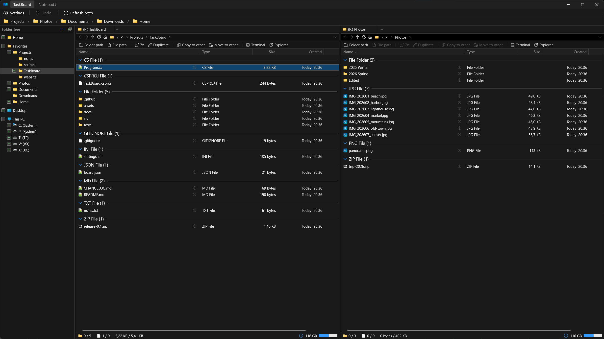
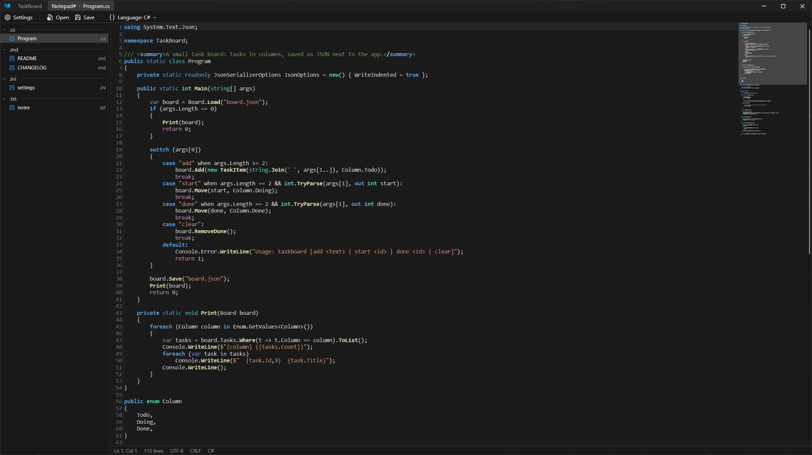

# DirectoryFable

A two-pane file manager for Windows with a built-in text editor, Notepad#, an
image viewer, AstraViewer, a fast file search, SonnetSearch, and a video player,
OpusHC.
Dark, dense and made for the keyboard. Written in C# with WPF on .NET 10.



## Download

Get `DirectoryFable_<version>.zip` from the
[latest release](https://github.com/KintaroModding/directoryfable/releases/latest),
unpack it into a folder of its own and start `DirectoryFable.exe`. It needs the
[.NET 10 Desktop Runtime (x64)](https://dotnet.microsoft.com/download/dotnet/10.0).
Later versions come through the `Update` button in the title bar. To build it
yourself, see [Build](#build).

## Explorer

- **Two panes with tabs.** Each tab keeps its own folder, history, sort order
  and columns. `Ctrl+T` opens a tab, `Ctrl+W` closes it, `Ctrl+Shift+T` brings
  back a closed tab. Drag a tab to move it.
- **Folder tree and favorites bar**, shared by both panes; they act on the
  active pane. The tree shows Home, Favorites, Desktop and This PC. It follows
  the active pane, or stays where it is (toggle in its header). "Collapse all"
  goes back to the overview.
- **Address bar** with clickable parts; it turns blue on a network path
  (`\\server\share` or a mapped network drive). Type a path with `Ctrl+L`, `Alt+D` or
  `F4`; environment variables like `%APPDATA%` work.
- **This PC**: the drives with a usage bar (red from 90 % used), file system,
  how full and free of total, in "Devices and drives" and "Network locations"
  (with the share). Open it from the tree, by typing `This PC`, or with Up from
  a drive. Double-click or `Enter` opens a drive, a middle click opens it in a
  new tab, right-click shows Windows' menu for it ("Space usage" opens the Space
  view); the values update while you look. Below the drives: **Recent folders**,
  the folders you opened last in any pane or tab (how many: settings page, 0 to
  100; right-click one to remove it from the list).
- **Details view** with group dividers by file type. Sort, resize and reorder
  the columns. Hidden and system files are always shown.
- **Folder sizes** in the Size column (NTFS drives, run as administrator): the
  first folder on a drive reads its file table once (about a second for a
  system drive), then every folder on it shows its size at once; sorting by
  size and the status bar count them too. The sizes stay live: every few
  seconds (10 by default, a setting) DirectoryFable looks at the drive's change
  journal (Windows' list of file changes) and lists only the folders that
  changed again; `F5` reads the whole drive again. Only reading, nothing is
  written to the drive (a drive without a journal is read again at most once a
  minute after a change). Switch it off on the settings page or in the column
  header's right-click menu.
- **Space view** (`Space` button in the quick bar): what takes the space in the
  shown folder, biggest first. Folders show the size, files and folders of
  everything below them, and every row has a bar for its share; at a drive
  root also files, other used space and free space. Open a folder to go deeper
  (Back, Up and the address bar work as usual), `Esc` returns to the list, `F5`
  reads again. NTFS drives as administrator are read from their file table;
  network folders and other drives with a folder walk. Below the list a **block
  chart**: every file and folder as a box sized by its space, files coloured by
  kind (video, images, archives, programs, ...); point at a box to see its path
  and size, click to select its row, double-click to open. `Blocks` switches it
  on and off; drag the line above it to change its height.
- **Quick filter**: type in the list and only the names that match stay
  (words in any order, `*` and `?` as wildcards); the box at the right end of
  the quick bar shows the text and "shown / all". `Backspace` takes back a
  character, `Esc` shows all again, another folder starts without a filter.
- **Auto-refresh**: the lists and the tree follow changes on disk.
- **File operations through Windows** (Recycle Bin, elevation).
- **Own question for names that are taken**: before a copy or move starts,
  DirectoryFable finds the names that already exist in the target (also inside
  folders that are merged) and asks in a dark dialog: Replace, Replace if newer,
  Skip or Keep both (`name (2).ext`), with sizes and dates side by side (newer
  and larger marked) and "do the same for the other conflicts" ("if newer" then
  decides for each item by its own dates). Cancel changes nothing. **Undo** (`Ctrl+Z`) for copy, move, rename, duplicate and delete
  to the Recycle Bin.
- **Own dark progress window** for copy, move and delete: from / to, the
  current item, current and average speed (items per second for a delete),
  elapsed time and time left, items and size left, Pause / Resume and Cancel
  (closing the window cancels too). `Shift+Delete` asks in a dark dialog; when
  Windows has a question of its own (an item that cannot go to the Recycle Bin,
  a file in use), it stays in front of the window. `Details`
  slides open the full paths of from, to and the current item (right-click one
  to copy it). It shows only for operations that take longer than a moment.
- **Rectangle selection**: hold the left button on empty list space, or on a
  row outside its name, and drag; `Ctrl` adds to the selection. The list
  scrolls when you drag past its top or bottom.
- **Drag and drop** between the panes, tabs, the tree, the favorites and other
  programs. A right-button drag asks what to do; dropped into the same folder,
  it makes a copy under a new name.
- **The Windows context menu** in dark mode, so your shell extensions work.
- **Quick actions bar** in each pane, in two rows. First: Folder path, File
  path, 7z (7-Zip's "Add to archive" window), Duplicate, Copy to other, Move to
  other. Second: Terminal (Command Prompt or PowerShell), Explorer,
  SonnetSearch (search this folder and its subfolders, like `Ctrl+F`), Space
  (the Space view), and the quick filter box. "Quick bar: icons only" on the
  settings page hides the labels for narrow panes.
- **Archives as folders**: ZIP read and write; 7z and RAR read only, through an
  installed [7-Zip](https://www.7-zip.org/).
- **Properties window** (`Alt+Enter` or the info button on a row): first
  General, as Windows' General tab (type, location, size and size on disk with
  the exact bytes, what a folder contains - counted while you look -, dates,
  attributes; drives: capacity, used, free, file system), then the details
  Windows knows for the file type (for example image size, artist, page count).
  Read-only, Hidden, System and Archive are check boxes that change the item at
  once.
- **Status bar**: selected and total folders, files and size; free space.
- **Settings page** behind the gear button. A normal window with a taskbar
  button (the default), or tray mode: only a tray icon, and closing the window
  hides it. Only one copy runs.
- **Session**: window, tabs, columns and the open Notepad# files come back at
  the next start.

## Notepad#



- A second view in the title bar: `[folder] [Notepad#]`. Both views keep their
  state.
- **Open files in a vertical list**, in groups of your own and in automatic
  groups (by type or by folder). Drag files and groups to order them.
- **Icons for files**: right-click a file in the list, `Icon`, and pick one of
  24 (star, flag, bug, to-do list ...). A red dot on it shows unsaved changes.
  `Default icon` goes back to the normal symbol. The icons are kept in the
  session.
- **Editor** based on [AvalonEdit](https://github.com/icsharpcode/AvalonEdit):
  line numbers, syntax highlighting for the languages AvalonEdit knows plus
  AutoHotkey, INI and Technical Notes, chosen per file, and word wrap (`Alt+Z`).
- **Technical Notes**: highlighting for plain-text notes and logs: dates and
  times, status words (`TODO`, `FIXED`, `ERROR`), paths, file names, dotted
  members, brackets (colored by depth), quotes, numbers; capitalized words
  always stand out. `.tnotes` files get it at once; for any other file choose
  it in the Language menu.
- **Search** (`Ctrl+F`) in a dark search box: match case, whole words, regular
  expressions.
- **Minimap** beside the scroll bar: click to jump, drag to scroll.
- **The full path** of the shown file just above the first line; right-click
  it to copy it or to show the file in the explorer.
- **New files** (`Ctrl+N`) and **Save as** (`Ctrl+Alt+S`).
- **Nothing is lost on exit.** Unsaved changes and new files that were never
  saved come back at the next start, also after a crash (they are kept a few
  seconds after you stop typing). `Ctrl+Z` after a restart goes back to the
  saved text.
- **Changes from other programs**: a file without unsaved changes is reloaded
  by itself; with unsaved changes, Notepad# asks first.
- Files keep their encoding and line endings.
- **A file deleted outside stays in the list** in red and read-only, with its
  text, also after a restart. Save writes it back.
- **Open from the explorer** with the context menu, `Ctrl+E`, by dragging files
  onto the `[Notepad#]` tab or into Notepad#, or with a double-click on the file
  types you choose. The double-click works only inside DirectoryFable; the file
  associations of Windows do not change.

## AstraViewer


- A third view in the title bar: `[folder] [Notepad#] [AstraViewer]`.
- **Opens only from DirectoryFable**: a double-click (or Enter) on the image
  types you choose, "Open in AstraViewer" in the right-click menu, or images
  dropped onto the `[AstraViewer]` tab. The file associations of Windows do
  not change.
- **History** on the left: the images you opened, the newest at the top.
  Click one to show it again; the order stays. A right-click on the image or
  on a thumbnail adds that image ("Add to history").
- **The image** fits into the window (or starts at 100 %). Mouse wheel = zoom
  at the mouse, drag = move, double-click = fit / 100 %, `R` = rotate the view
  (the file is not changed). Transparent parts show a checkerboard.
- **Thumbnails** of the other images in the folder, with "n / N", like VS
  Code's image preview. The arrows next to "n / N", `Left` / `Right` or the
  mouse side buttons go to the previous / next image.
- **Properties** below: size in pixels, format, color depth, DPI, file size,
  dates, camera (when the photo has it).
- Settings: start zoom, background (dark, black, light), checkerboard,
  thumbnail size (small, medium, large), history size, and the image types. JPEG / TIFF orientation (EXIF) is applied; icons
  show their largest size; very large images are decoded smaller.
- Formats: those that Windows can read (PNG, JPEG, BMP, GIF, TIFF, ICO, WebP,
  JPEG XR; HEIC and AVIF with the matching Windows codecs). Animated GIFs show
  their first frame.

## SonnetSearch

- The fourth view in the title bar, `[SonnetSearch]`. `Ctrl+F` in the explorer
  searches the shown folder and its subfolders.
- **Whole drives in seconds**: run as administrator, DirectoryFable reads each
  NTFS drive's file table directly (millions of files in a few seconds; it only
  reads). Without administrator rights, and on other drives, it walks the
  folders instead (slower).
- **Name search while you type**: words in any order, `*` and `?` wildcards
  (`*.sav`), "quoted text", match case, regular expressions.
- **Places**: drive toggles in the bar, plus a drop-down list of drives (total
  size, free space, % free) and added folders, each with a tick box and a
  folder tree to tick subfolders. Ticked folders show in the bar.
- `Reset` empties the text and the filters (places and the mark stay).
- **Filters**: type (files, folders, images, text, own extensions), size, and
  a date range for Last Modified, Creation Date, Last Accessed or any of them.
- **Time mark**: `Set mark` remembers the moment; "Since the mark" then shows
  only what changed after it (for example where a game wrote its save file).
- Columns: `#` (row number), Name, Containing Path, Size, Last Modified,
  Last Accessed, Creation Date, Type; every second row is a little lighter.
  Click a header to sort (size and dates: biggest / newest first). The results open, drag, copy and have the Windows menu like
  the files in the explorer.
- **Scroll rail** instead of a scroll bar: the thumb stays big enough to grab
  with millions of results, and a click anywhere jumps there. With the mouse
  on the rail, a panel shows where each part of the sort order starts
  (`Today`, `Oct 2026`, `≥ 1 GB`, `A`, `C:\Users`, `.txt`) and a bubble shows
  the value and row at the cursor. Click a label to go to the start of that
  part.
- A drive is read once; typing and filters search what was read. `Enter`,
  `F5` or `Search` read the drives again, so new files show.

## OpusHC

- The fifth view in the title bar. A double-click (or `Enter`) on a video in
  the explorer plays it here; the types are a setting (MP4, MKV, MOV, AVI, WebM,
  ... by default). Only inside DirectoryFable: Windows' defaults stay.
- **VLC's engine, portable**: it plays with libVLC from the VideoLAN project,
  which is not part of the download. Until it is there, OpusHC shows why it is
  needed, the exact address it comes from and the exact folder it goes to, with
  a Download button: the official VLC zip from download.videolan.org (about 79
  MB), checked against VideoLAN's SHA-256 checksum; only the engine files (about
  140 MB) are kept in `data\vlc\` next to the exe. Nothing is installed in
  Windows; `Remove` in the player's settings (or deleting the folder) takes it
  away.
- Timeline with scrubbing (drag it and the picture follows; the time under the
  mouse shows above it), play / pause, previous / next video in the folder,
  volume and mute, audio track and subtitles, full screen (the controls hide
  while the mouse rests).
- **Filmstrip** above the timeline: the whole video as a row of small pictures
  (made in the background in a few seconds, kept in memory only). Point at it,
  or at the timeline, to see the picture of that moment bigger; click to jump
  there. In the player's settings: on / off, and a slider for how many
  pictures (20 to 200; 40 by default).
- **Resume**: a video starts where you left it (the last 300 videos). At the end
  the next video of the folder plays (for series). Both are settings.
- Keys: `Space` play / pause, `Left` / `Right` 5 s (`Ctrl`: 30 s), `Up` /
  `Down` or the mouse wheel volume, `M` mute, `F`, `F11`, `Alt+Enter` or a
  double-click full screen (`Esc` leaves), `Page Up` / `Page Down` previous /
  next video, `Home` from the start.

## Updates

- `Update` in the title bar, left of the window buttons, opens a drop-down. It
  asks GitHub for the newest release and shows what changed: the release notes
  of every release since your version.
- `Update to <version>` downloads the release zip, checks its size, checksum
  and version, puts the new `DirectoryFable.exe` in place of the old one and
  starts again. Settings, favorites and the session stay.
- A quiet check a few seconds after the start shows a green checkmark on the
  button when you are up to date, or `Update <version>` (green) when a new
  version is out. The check sends only the app's name and version to GitHub.
- In the drop-down: switch the check at start on or off, or remove the update
  check entirely (asks first; the button leaves the title bar). The settings
  page, section Updates, has both switches and brings the button back.

## Requirements

- Windows 11, x64. Windows 10 is not tested.
- To run: the [.NET 10 Desktop Runtime (x64)](https://dotnet.microsoft.com/download/dotnet/10.0).
- To build: the .NET 10 SDK.
- Optional: 7-Zip, for the 7z button and for 7z and RAR archives. It is found
  automatically, or set its folder on the settings page.

## Data folder

DirectoryFable is portable. It keeps its files in a `data` folder next to the
exe and writes nothing to AppData or the registry:

| File | Content |
|---|---|
| `settings.json` | Settings, with a comment for each key. The settings page writes it. |
| `favorites.json` | The favorites bar. |
| `session.json` | Window, tabs, columns, Notepad# files, the AstraViewer history and where videos were left. |
| `notepad-cache\` | Notepad# texts kept over a restart: unsaved changes, new files, files deleted outside. |
| `vlc\` | VLC's engine for OpusHC, only after you agreed to download it. |

## Command line

```text
DirectoryFable.exe [leftFolder] [rightFolder] [--multi] [--taskbar|--tray] [--data=<folder>]
```

- `leftFolder`, `rightFolder`: open the panes in these folders.
- `--multi`: start another copy, even when one is running.
- `--taskbar`, `--tray`: the window mode for this run.
- `--data=<folder>`: use another data folder.

## Keyboard

| Keys | Action |
|---|---|
| `Tab` | Switch the active pane |
| `Ctrl+T` / `Ctrl+W` / `Ctrl+Shift+T` | New tab / close tab / reopen a closed tab |
| `Ctrl+Tab` / `Ctrl+Shift+Tab` | Next / previous tab |
| `Alt+Left` / `Alt+Right` | Back / forward |
| `Alt+Up` or `Backspace` | Up one folder |
| `Ctrl+L`, `Alt+D`, `F4` | Type a path |
| `F5` | Refresh |
| `Ctrl+C` / `Ctrl+X` / `Ctrl+V` | Copy / cut / paste files |
| `F2` | Rename |
| `Del` / `Shift+Del` | To the Recycle Bin / delete for good |
| `Ctrl+Shift+N` | New folder |
| `Ctrl+Z` | Undo the last file operation |
| `Alt+Enter` | Properties window |
| `Ctrl+E` | Open the selected files in Notepad# |
| `Ctrl+F` | Search in the shown folder |
| Notepad#: `Ctrl+N` / `Ctrl+O` / `Ctrl+W` | New / open / close a file |
| Notepad#: `Ctrl+S` / `Ctrl+Shift+S` / `Ctrl+Alt+S` | Save / save all / save as |
| Notepad#: `Ctrl+F`, then `F3` / `Shift+F3` | Search, next / previous match |
| Notepad#: `Alt+Z` | Word wrap on / off |
| Notepad#: `Ctrl+Tab` | Next file |
| AstraViewer: `Left` / `Right`, `Home` / `End` | Previous / next, first / last image |
| AstraViewer: `F` / `1` / `+` / `-` | Fit / 100 % / zoom in / zoom out |
| AstraViewer: `R` / `Shift+R`, `Ctrl+C`, `F5` | Rotate the view, copy the image, read the folder again |
| SonnetSearch: `Enter` / `F5`, `Esc` | Read the drives again and search, stop reading |
| SonnetSearch: `Ctrl+C` / `Ctrl+Shift+C` | Copy the found files / their paths |

## Build

```powershell
dotnet build DirectoryFable.sln
.\build.ps1
```

`build.ps1` publishes one framework-dependent `DirectoryFable.exe` into `dist\`
and makes the release zip `dist\release\DirectoryFable_<version>.zip` (the exe,
`LICENSE`, `NOTICE.md`). The version is `<Version>` in
`src\DirectoryFable\DirectoryFable.csproj`. A GitHub release tagged `v<version>`
with this zip attached is what the `Update` button installs; its release notes
are the changelog the app shows.

## Solution layout

```text
src/DirectoryFable/
  Views/           Windows, panes, bars, dialogs and the Notepad# view (XAML + code).
  ViewModels/      Tabs, panes, folder tree, favorites.
  Models/          File items and favorites.
  Infrastructure/  Settings, session, folder watchers, sorting, formatting.
  Shell/           Windows shell: icons, context menu, file operations, undo, archives, 7-Zip.
  Editor/          Notepad#: documents, groups, syntax highlighting, minimap.
  Viewer/          AstraViewer: image loading, thumbnails, image types.
  Search/          SonnetSearch: NTFS file table reader, folder walk, query and sorting.
  Updates/         The Update button: GitHub releases, release notes, download, exe swap.
  Themes/          Colors and control styles.
  Assets/          The app icon and the icons of the built-in views.
```

## Contributing

Contributions are welcome: see [CONTRIBUTING.md](CONTRIBUTING.md). Everyone who
contributes is named in [CONTRIBUTORS.md](CONTRIBUTORS.md).

## License

GNU General Public License, version 3 ([LICENSE](LICENSE)), with additional
terms under its section 7 ([NOTICE.md](NOTICE.md)): a work based on this program
keeps the credit to the original and its contributors, is marked as a modified
version with a name of its own, and gets no rights to the names "DirectoryFable"
and "KintaroModding". The licenses of the libraries are in
[licenses](licenses).
